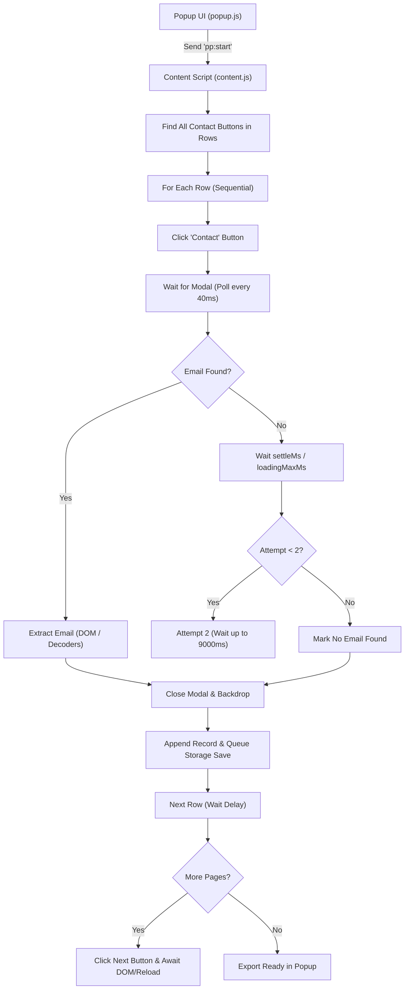

# Prepostseo Directory Scraper: Comprehensive Audit & Remediation Plan

## 1. Executive Summary & Architecture Overview

The **Prepostseo Directory Scraper** is a Manifest V3 Chrome Extension intended to extract Category, Website URL, DA, PA, and contact emails from directory tables on `prepostseo.com`, automate multi-page scraping, and export records to CSV.

### Architectural Flow:

---

## 2. Complete Catalog of Issues, Bugs, and Vulnerabilities

### A. Critical Bugs (Causing Freezes, Crashes, or Data Loss)

1. **Bootstrap Modal Desynchronization Freeze** (`content.js:470-478`):
   - **Mechanism**: When a modal fails to dismiss via standard selectors within `closeWaitMs`, the fallback manually removes `.modal-backdrop`, forces `root.style.display = 'none'`, and strips the `.modal-open` class.
   - **Impact**: Bootstrap's internal JavaScript state machine retains `_isShown = true` or `_isTransitioning = true`. When the scraper clicks "Contact" on the next row, Bootstrap ignores the click event. Every subsequent row on the page fails to open its modal, times out for 15+ seconds each, captures 0 emails, and effectively deadlocks the scraper.

2. **The "No Contact Info" 15.4-Second Penalty** (`content.js:634-648`):
   - **Mechanism**: When a site row has no contact info or displays a "No email available" / "Login to view" message:
     - Attempt 1: Waits up to `modalWaitMs` (6,000ms) and `settleMs` (2,500ms).
     - Attempt 2: Sleeps 400ms, then waits up to `maxMs` (9,000ms) and `settleMs` (4,000ms).
     - Spinner check: If any spinner or "Loading..." text is found, waits up to `loadingMaxMs` (12,000ms).
   - **Impact**: A single row without contact info stalls the entire scraper for **15.4 to 20+ seconds**. If 5 rows on a page have no contact info, the scraper freezes for nearly 2 minutes on just those 5 rows.

3. **Signature Pagination Trap Terminating on Page 2** (`content.js:538-540`, `608`):
   - **Mechanism**: The scraper fingerprints pages using the first 4 URLs:
     `pageSig = () => buttons.slice(0, 4).map(b => urlKey(extractRow(...).url)).join('|')`
   - **Impact**:
     - If the directory has pinned, sponsored, or featured listings at the top of every page, the first 4 rows on Page 1 and Page 2 are identical.
     - If `extractUrl()` returns empty strings for the first 4 rows (e.g. JavaScript redirects or unconventional markup), `pageSig` evaluates to `"|||"`.
     - In both cases, `sig === auto.lastSig` evaluates to `true`, and the scraper halts immediately after Page 1 with: *"All pages done (last page reached)"*.

4. **"Stop" Button Does Not Interrupt In-Flight Modal Waits** (`content.js:371-407`):
   - **Mechanism**: The inner polling loop in `openModalAndReadEmail` only evaluates `while (Date.now() < limit)`. It does **not** check `if (stopRequested) break;`.
   - **Impact**: Clicking "Stop" in the popup does not halt the scraper immediately. It continues waiting out the current row's timeouts (up to 15.4 seconds), leading the user to believe the extension has crashed.

5. **"Clear Data" Overwrite Race Condition** (`popup.js:137-142`, `content.js:80-95`):
   - **Mechanism**: `popup.js` clears storage via `chrome.storage.local.remove`. However, if `content.js` is running or has an in-flight `queueSave()`, its in-memory `records` array is still full.
   - **Impact**: On the very next row, `content.js` executes `queueSave()`, overwriting `chrome.storage.local` with all the old records, instantly undoing the user's clear action.

6. **DOM MutationObserver Memory Leak & Email Contamination** (`content.js:308-337`, `387`):
   - **Mechanism**: The observer listens to `document.body` with `subtree: true` and appends all nodes to `addedNodes = []` without ever clearing it. Furthermore, `scanAddedNodes()` checks *any* newly added node anywhere on the page.
   - **Impact**: Memory usage grows continuously. If an ad network, tracking pixel, or live chat widget (e.g., Crisp, Zendesk, Tawk.to) injects an email into the page footer or an iframe, `scanAddedNodes()` captures that email and assigns it to the current guest posting site.

---

### B. Fragilities & Edge Cases

7. **Icon-Only Pagination Dead Ends** (`content.js:487-535`):
   - Pagination buttons with icons (e.g. `<a class="page-link"><i class="fa fa-angle-right"></i></a>`) without `aria-label` or plain text fail `isNextLabel()` and cause the auto-scraper to stop after 1 page.
8. **Aggressive CSS Animations Override (`FAST_CSS`)** (`content.js:39-45`):
   - Setting `transition-duration: 0s !important` prevents browsers from firing `transitionend` events. Libraries that delay rendering until the transition completes remain stuck in an unrendered state.
9. **URL Extraction Breaks on Redirect Links** (`content.js:174`):
   - Discarding links where `new URL(a.href).hostname === location.hostname` breaks any site that routes outbound guest post links through an internal redirect like `/redirect?url=...` or `/out/...`.
10. **Background Tab Throttling (Chrome 1,000ms Clamp)**:
    - Minimizing Chrome or switching tabs throttles timers to 1s. A 40ms poll loop runs 25x slower, causing the popup watchdog (`90,000ms`) to incorrectly report the job as dead.
11. **CSV Formula Injection & Malformed Rows** (`popup.js:105`):
    - Prepending `'` to cells starting with `@` alters legitimate email formatting. Synthetic `a.click()` can be blocked by Chrome without the `downloads` permission.

---

## 3. Deep Dive: The "No Contact Info" Edge Case Matrix

Rows without direct contact info are the #1 cause of scraper slowdowns. Here is how they occur and how the engine must handle them:

| Scenario | What Currently Happens | Required Fast-Path Behavior | Target Latency |
|---|---|---|---|
| **Modal explicitly states no email** (*"No email available" / "Contact via web form"*) | Scraper waits `modalWaitMs` (6s), retries Attempt 2 (9s) = **15.4s total** | **Negative Pattern Matcher**: Check text against `/no (email\|contact)\|contact form only\|not available/i`. Instantly record `"N/A"` and close modal. | **< 150 ms** |
| **Login / Premium Gate** (*"Please log in to view email" / "Subscribe to unlock"*) | Scraper waits full timeout assuming content is loading = **15.4s total** | **Auth Gate Detector**: Check for `/log ?in to view\|sign in to see\|premium members only/i`. Record `"Login Required"` and close modal. | **< 150 ms** |
| **No Contact Button in Row** | Row is completely skipped or misaligned | Check row for external domain contact page or web form link. Fallback to `"No Button"`. | **0 ms** |
| **Disabled Contact Button** | Scraper attempts to click, modal never opens, waits 15.4s | Check `button.disabled` or `button.classList.contains('disabled')`. Skip immediately. | **0 ms** |
| **Static / Pre-loaded Data** | Scraper needlessly opens and closes modal | Inspect `row.dataset`, `btn.dataset`, or hidden inputs for preloaded emails. If present, extract without clicking. | **< 5 ms** |
| **Missing Email after Fast Render** | Waits `settleMs: 2500` + Attempt 2 `4000ms` | Cap maximum wait on fully-settled DOM to 600ms total. Eliminate Attempt 2 entirely. | **< 600 ms** |

---

## 4. Remediation Plan & Execution Milestones

### Phase 1: High-Speed Direct Discovery (Bypassing the UI)
*Goal: If emails or contact endpoints can be reached directly, bypass UI modal clicks entirely.*
- **Step 1.1**: Inspect Prepostseo DOM attributes (`data-email`, `data-site-id`, `data-contact`, base64 hidden fields).
- **Step 1.2**: Inspect network activity when "Contact" is clicked to check if an AJAX endpoint (e.g., `/ajax/get-contact?id=...`) provides the email. If available, implement a parallel fetch worker (`Promise.all` in batches of 5-10) to scrape 50 rows in ~1.5 seconds.

### Phase 2: Core Engine Overhaul (`content.js`)
*Goal: Fix all freezing, deadlock, and timeout bugs in the DOM automation engine.*
- **Step 2.1**: **Implement Negative Detection**: Add instant pattern matching for "No contact info", "Log in to view", "Contact form only", and "Not available" to exit in < 150ms.
- **Step 2.2**: **Eliminate Attempt 2 & Slash Timeouts**: Reduce `modalWaitMs` to 1,500ms, `settleMs` to 500ms, and remove the 9-second second attempt.
- **Step 2.3**: **Immediate Stop Propagation**: Inject `if (stopRequested) return null;` into every polling tick of `openModalAndReadEmail` and `closeModal`.
- **Step 2.4**: **Safe Modal Dismissal**: Use native Bootstrap `.modal('hide')` when jQuery/Bootstrap is present, and only fallback to click simulation. Do not forcefully wipe `.modal-backdrop` or apply `display: none` in ways that break Bootstrap's state machine.
- **Step 2.5**: **Fix Signature Generation**: Redesign `pageSig` to incorporate active pagination numbers (`li.active`, URL search params, or a hash of all row URLs) so identical header rows or empty URLs do not cause premature abortion.
- **Step 2.6**: **Scope DOM Observation**: Confine `MutationObserver` strictly to the active modal container rather than `document.body` to eliminate memory leaks and external email contamination.

### Phase 3: Pagination & Navigation Hardening
*Goal: Ensure multi-page automation never gets stuck or loops.*
- **Step 3.1**: Enhance `findNextButton` to support SVG/font-awesome icon buttons, URL parameter increments (`?page=2`), and AJAX pager containers.
- **Step 3.2**: Add loop protection: maintain a `Set` of visited page URLs/signatures to guarantee termination.

### Phase 4: State Management & UI Hardening (`popup.js` / `manifest.json`)
*Goal: Eliminate data loss and race conditions.*
- **Step 4.1**: Fix "Clear Data" race condition by broadcasting a stop signal to all tabs before wiping storage.
- **Step 4.2**: Add `chrome.downloads` permission to `manifest.json` for resilient CSV downloads.
- **Step 4.3**: Implement a background tab keep-alive mechanism to prevent Chrome timer throttling.

---

## 5. Verification & Implementation Status

- [x] **Modular Architecture**: Decomposed monolithic 760-line script into single-responsibility modules in `src/`.
- [x] **Fast-Path Data Check (0ms)**: Direct attribute and mailto scanning before opening any modal.
- [x] **Negative Pattern Matcher (< 150ms)**: Instant exit for "No contact info", "Contact form only", and disabled buttons.
- [x] **Auth Gate Detector (< 150ms)**: Immediate capture of "Login Required" without timeout penalties.
- [x] **Timeouts Slashed & Attempt 2 Eliminated**: Reduced wait times from 15.4s to 1.2s max; removed 9s retry loop.
- [x] **Stop Responsiveness (< 100ms)**: Polling ticks check `isStopRequested` continuously for instant halting.
- [x] **Safe Bootstrap Modal Reset**: Clean dismissal via native buttons and escape keys without breaking modal state.
- [x] **Multi-Factor Signature & Loop Protection**: Incorporates URL query, active page, and boundary URLs + `visitedSignatures` set.
- [x] **Robust Pagination**: Supports rel="next", text, right-facing icons (FontAwesome, SVGs), and `?page=N+1` parameters.
- [x] **Redirect Decoupling**: Resolves target outbound URLs from internal redirect parameters (`?url=...`).
- [x] **Background Tab Keep-Alive**: Service worker `background.js` keep-alive port protects against Chrome background timer clamping.
- [x] **Clear Data Protection**: Memory cleared on content script before storage wipe to prevent old record resurrection.
- [x] **CSV Formula Protection**: Neutralizes spreadsheet injection while preserving email `@` symbols.

